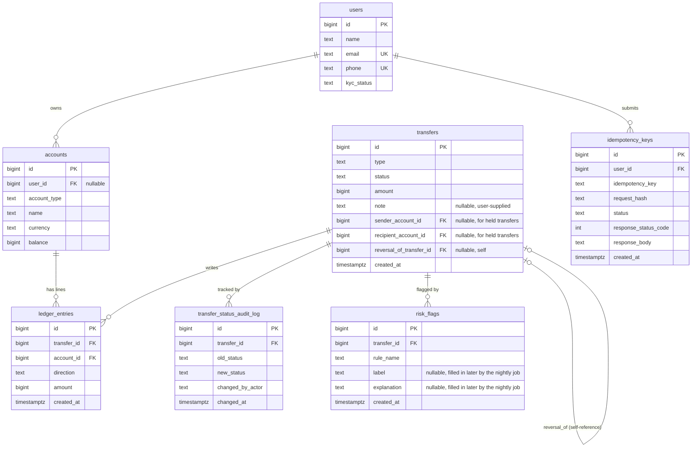

# Milestone 1 — Schema Design

## 1. Noun list → table decisions

Every noun from the requirements brief, and whether it became a table.

| Noun | Table? | Why / why not |
|---|---|---|
| User | Yes → `users` | Has its own attributes (name, email, phone, KYC status) that must be stored and don't belong to any other entity. |
| Wallet | Yes → `accounts` (`account_type = 'user_wallet'`) | A wallet is an account owned by a user. Merged into the same table as system accounts (see below) rather than a separate `wallets` table. |
| System account (cash-in, cash-out, fee revenue) | Yes → `accounts` (`account_type = 'system_*'`) | Also needs a balance and participates in ledger entries exactly like a wallet does. Kept in the same table as wallets instead of a separate `system_accounts` table — see rationale below. |
| Currency | No table | The brief fixes this to INR only. A single `CHECK (currency = 'INR')` constraint on `accounts` is enough; a separate `currencies` table would only be needed if more currencies were supported. |
| Transfer | Yes → `transfers` | The business event itself: type, status, amount, created time — all direct attributes. |
| Ledger entry | Yes → `ledger_entries` | The debit/credit line. Has its own attributes (direction, amount) and its own immutability rule, so it must be a dedicated table, not a column on `transfers`. |
| Idempotency key | Yes → `idempotency_keys` | Needs its own uniqueness constraint `(user_id, key)` and stores a saved response — doesn't fit as a column on any other table. |
| Transfer status change | Yes → `transfer_status_audit_log` | The brief explicitly requires keeping a history of every status change, with who changed it and when — this is multiple rows per transfer, so it needs its own table. |
| Risk rule | Yes → `risk_rules` (Milestone 5) | One row per fraud rule, storing its thresholds - kept out of code so they can be tuned without a deploy. |
| Risk flag | Yes → `risk_flags` (Milestone 5) | One row per transfer a rule flagged; label/explanation start NULL and are filled in later by the nightly job's LLM step. |
| Reconciliation job | Yes → `job_locks` (Milestone 4) | One row per background job, locked via `SELECT ... FOR UPDATE NOWAIT` to guarantee only one run at a time. |
| Reconciliation run | Yes → `reconciliation_runs` (Milestone 4) | One row per nightly run: start/end time, status, summary counts. |
| Reconciliation issue | Yes → `reconciliation_issues` (Milestone 4) | One row per problem found in a run (check name, entity, expected vs actual) — multiple per run, so needs its own table. |

## 2. Cardinality decisions

| Relationship | Cardinality | Foreign key placement |
|---|---|---|
| User → Accounts (wallets) | 1:M (a user can have many wallets) | FK `accounts.user_id` → `users.id` (the "many" side holds the FK) |
| Transfer → Ledger entries | 1:M (one transfer always has 2+ entries) | FK `ledger_entries.transfer_id` → `transfers.id` |
| Account → Ledger entries | 1:M (an account accumulates many entries over its lifetime) | FK `ledger_entries.account_id` → `accounts.id` |
| User → Idempotency keys | 1:M (a user submits many requests over time) | FK `idempotency_keys.user_id` → `users.id` |
| Transfer → Transfer (reversal) | 0/1:1 (a reversal transfer points to exactly one original; an original may have 0 or 1 reversal in practice, though the FK itself doesn't force that limit) | FK `transfers.reversal_of_transfer_id` → `transfers.id` (self-referencing) |
| Transfer → Audit log entries | 1:M (a transfer accumulates one row per status change) | FK `transfer_status_audit_log.transfer_id` → `transfers.id` |

No M:N relationships exist in this schema — every relationship here is 1:M, resolved by placing the foreign key on the "many" side. No mapping/junction tables are needed.

## 3. ER Diagram

## 4. Constraints enforced by the database (not just application code)

| Constraint | Table | How |
|---|---|---|
| Ledger entry amount must be positive; direction stored separately | `ledger_entries` | `CHECK (amount > 0)`, `CHECK (direction IN ('debit','credit'))` |
| A user wallet's balance can never go negative | `accounts` | `CHECK (account_type <> 'user_wallet' OR balance >= 0)` |
| Ledger entries can be inserted but never updated or deleted | `ledger_entries` | `BEFORE UPDATE OR DELETE` trigger that raises an exception |
| Idempotency key unique per user | `idempotency_keys` | `UNIQUE (user_id, idempotency_key)` |
| Currency is always INR | `accounts` | `CHECK (currency = 'INR')` |
| Wallets must belong to a user; system accounts must not | `accounts` | `CHECK` tying `account_type` to whether `user_id` is NULL |
| A reversal transfer must reference the original | `transfers` | `CHECK (type <> 'reversal' OR reversal_of_transfer_id IS NOT NULL)` |
| Indexes for real queries | `ledger_entries` | `(account_id, created_at DESC, id DESC)` for statements; `(transfer_id)` for per-transfer balance checks |

**Why a positive `amount` + separate `direction` column, instead of signed amounts (+500 / -500)?**

We chose positive amounts with a `direction` (`debit`/`credit`) column over signed amounts for two reasons. First, it matches how real accounting ledgers are taught and reported — a debit and a credit are different *kinds* of entry, not just a sign flip, and keeping them as separate concepts makes the data self-documenting (`direction = 'debit'` is readable at a glance; `-50000` requires remembering a sign convention). Second, it removes an entire class of bugs: with signed amounts, summing "all entries for a transfer" to check they balance to zero requires everyone to use the same sign convention everywhere, forever; with a positive amount and separate direction, the reconciliation query is simply "do debit amounts equal credit amounts", which can never be silently inverted by a sign mistake.

## 5. README design questions

**Do you store each account's balance, compute it from ledger entries, or both?**

We store `balance` as a real column on `accounts` (fast O(1) reads), while `ledger_entries` remains the source of truth. This costs us a small risk of drift if a bug ever updates the ledger without updating the cached balance — but that risk is caught every night by the Milestone 4 reconciliation job, which recomputes each account's balance from its ledger entries and reports any mismatch. The alternative (always computing `SUM(ledger_entries)`) can never drift, but it means every balance check — which happens on every single transfer — has to scan a growing number of rows, and that scan would happen while holding a row lock, increasing lock contention under load.

**Why store user wallets and system accounts in the same table?**

Every ledger entry needs exactly one account to debit or credit, regardless of whether that account is owned by a user or by the platform. If wallets and system accounts lived in two different tables, every piece of transfer code would need to branch on "is this a user account or a system account?" before it could lock the row, read the balance, or update it. Keeping them in one `accounts` table means the transfer logic (lock → check → update) is identical no matter which kind of account is involved.

**Which columns hold data you don't control, such as phone or email? Why is none of them a primary key?**

`users.email` and `users.phone` are both user-supplied and can change over time (a user can update their phone number or email address) or, in theory, be reused by a different person later. A primary key must be stable and immutable for the life of the row, so every table instead uses a database-generated `BIGINT` surrogate key (`id`) as its primary key, and declares `email`/`phone` as merely `UNIQUE` — enough to prevent duplicates without making them identity columns.

## 6. Assumptions made (not explicitly specified in the brief)

These are implementation decisions made to turn the brief into a concrete schema. None of them skip or contradict a requirement — they fill in details the brief left open.

- **`accounts.name`** (e.g. "Main Wallet", "Cash-In Account") — the brief only gives "main wallet"/"savings wallet" as an *example* of multiple wallets per user, without specifying how they're distinguished. A `name` column was added so a user's multiple wallets are distinguishable in API responses.
- **Exact enum value lists** — the brief names concepts ("a status", "KYC status") but never lists their exact allowed values. We chose:
  - `users.kyc_status`: `pending`, `verified`, `rejected`
  - `accounts.account_type`: `user_wallet`, `system_cash_in`, `system_cash_out`, `system_fee_revenue`
  - `transfers.status`: `held`, `completed`, `reversed` (no `pending`/`failed` — the fraud check resolves a transfer's status synchronously before commit, per Milestone 2's transaction design, and a business-rejected request never produces a committed transfer row at all)
  - `idempotency_keys.status`: `in_progress`, `completed` (a saved "completed" response can itself represent a business rejection, e.g. HTTP 422 — there's no separate "failed" state needed)
- **`transfer_status_audit_log.changed_by_actor`** is a plain text column (e.g. `"user:123"`, `"admin:5"`, `"system:reconciliation-job"`) rather than a structured actor table, to keep the audit log simple.
- **Storing `balance` as a column at all** (Option A) is itself a choice the brief poses as an open question rather than mandating — see the design question answer above for the reasoning.
- **No `created_at` on `users` or `accounts`** — the brief only explicitly requires a "created time" on `transfers`; timestamps were deliberately *not* added to other tables since no required feature reads them.

## 7. Revisions made in later milestones

- **`idempotency_keys.response_body`: `JSONB` → `TEXT`** (Milestone 3, `V2__idempotency_response_body_as_text.sql`). Originally modeled as `JSONB` for validation, but Postgres reformats `jsonb` on read (e.g. inserting a space after `:`), so a replayed response was not byte-identical to the original — failing the brief's "return the saved response exactly" requirement. Switched to plain `TEXT`, which preserves the exact bytes the application wrote.
- **`job_locks`, `reconciliation_runs`, `reconciliation_issues` added** (Milestone 4, `V3__reconciliation_job_tables.sql`) — see section 1 above.
- **`transfers.note` added** (Milestone 5, `V4__fraud_rules.sql`) — user-supplied note on a peer transfer, always treated as data (never instructions) when later shown to an LLM.
- **`risk_rules`, `risk_flags` added** (Milestone 5, `V4__fraud_rules.sql`) — see section 1 above.
- **`transfers.sender_account_id`, `transfers.recipient_account_id` added** (Milestone 5, `V5__transfer_parties.sql`) — a held transfer has no ledger entries yet (money hasn't moved), so these columns are the only way to know who a held transfer is between when an admin later releases or reverses it.

